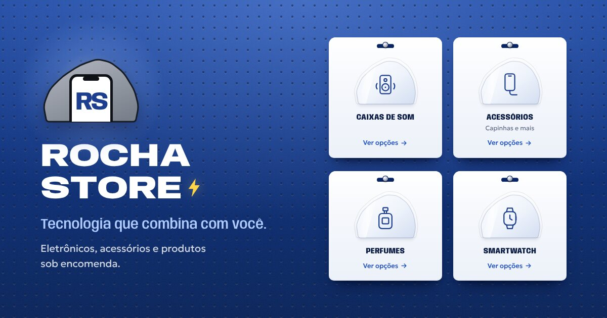

# Rocha Store · biolink

Página de "link na bio" da [@rochastore027](https://www.instagram.com/rochastore027/).
É HTML, CSS e JavaScript puro: não tem build e não depende de nada para instalar.



## O conceito

A página reproduz **a parede de ganchos de uma loja de acessórios**, onde as
cartelas de blister ficam penduradas:

- **A parede**: o fundo é uma chapa perfurada no azul cobalto dos posts da loja,
  com uma luz de vitrine no topo.
- **As cartelas**: cada categoria (os mesmos destaques do Instagram) é uma cartela
  com o furo de pendurar e um pino de metal. A bolha de plástico tem o formato da
  **rocha do logo**, e é isso que liga cada cartão à marca.
- **O balanço**: ao abrir a página, as cartelas são penduradas e assentam
  balançando. No hover ou no toque, balançam de novo a partir do pino. Quem ativa
  "reduzir movimento" no celular vê tudo parado.
- **O gancho vazio**: o último cartão está tracejado, sem produto. É a vaga de
  quem não achou o que procurava e leva direto para a encomenda.
- **A fita "NOVIDADE"**: é a mesma fita cinza dos posts e aparece uma vez só,
  no cartão do sorteio.

| Papel | Escolha |
|---|---|
| Parede | `#0B2F7E` cobalto (tirado dos posts) |
| Tinta | `#0B1C44` marinho · `#1E3F8F` azul do "RS" |
| Rocha | `#9298A2` cinza-pedra do logo |
| Cartela | `#F6F8FC` papel-cartão |
| Luz | `#AFCBFF` céu |
| Raio | `#FFD447`, usado só no ⚡ da marca |
| Título | **Anybody**, uma fonte de largura variável: expandida no nome da loja, como no logo, e condensada nas cartelas, como em embalagem |
| Texto | **Geologica**, sans de leitura limpa (o nome também puxa para "rocha") |

Cada cartão abre o WhatsApp com a mensagem já escrita para a categoria
(ex.: *"Olá, Rocha Store! Vim pelo link da bio e quero ver as opções de caixas de som."*).
Assim a loja já sabe o que a pessoa quer desde a primeira mensagem.

## Antes de publicar: 3 ajustes

Tudo fica em **`assets/js/config.js`**:

1. **WhatsApp**: preencha `whatsapp` só com números (55 + DDD + número), por exemplo
   `"5527999998888"`. Enquanto estiver vazio, os botões abrem o **direct do Instagram**
   e os textos mudam sozinhos para "Chamar no direct".
2. **Sorteio**: cole o link do post em `sorteio.link`. Quando o sorteio acabar,
   troque `ativo: true` para `false`.
3. **Pagamento**: confira se `"Pix e cartão"` está certo, ou deixe `""` para esconder.

## Outras edições comuns

- **Mudar ou adicionar categorias**: edite a lista `categorias`. Os ícones disponíveis são
  `caixa`, `acessorio`, `perfume`, `relogio`, `gamer`, `powerbank` e `fone`.
- **Usar foto de produto no lugar do ícone**: salve um PNG sem fundo em `assets/img/` e
  coloque `foto: "assets/img/nome.png"` na categoria. A foto aparece dentro da bolha.
- **Logo**: o emblema do topo é um redesenho em vetor do logo atual (rocha + celular + RS).
  Se quiser usar o arquivo original, troque o `<svg class="emblema__svg">` no
  `index.html` por um ``.

## Publicar (GitHub Pages, grátis)

1. No GitHub, abra **Settings → Pages**.
2. Em *Source*, escolha **Deploy from a branch**, depois a branch e a pasta `/ (root)`.
3. O link sai no formato `https://<usuario>.github.io/biolink-rochastore/`. Coloque esse
   link no campo "site" do perfil do Instagram.
4. Para a prévia aparecer bonita quando o link for enviado no WhatsApp, troque no
   `index.html` o valor de `og:image` pelo endereço completo, por exemplo
   `https://<usuario>.github.io/biolink-rochastore/assets/img/og.jpg`.

Também funciona em Netlify, Vercel ou Cloudflare Pages: basta arrastar a pasta.

## Estrutura

```
index.html             página
assets/css/style.css   todo o visual
assets/js/config.js    textos, links e categorias (o que você edita)
assets/js/main.js      monta os cartões e os links
assets/img/            favicon, ícone do iPhone e imagem de compartilhamento
og/index.html          molde usado para gerar assets/img/og.jpg (1200×630)
```

## Testar no computador

```bash
python3 -m http.server 8000
```

Depois abra `http://localhost:8000`.
